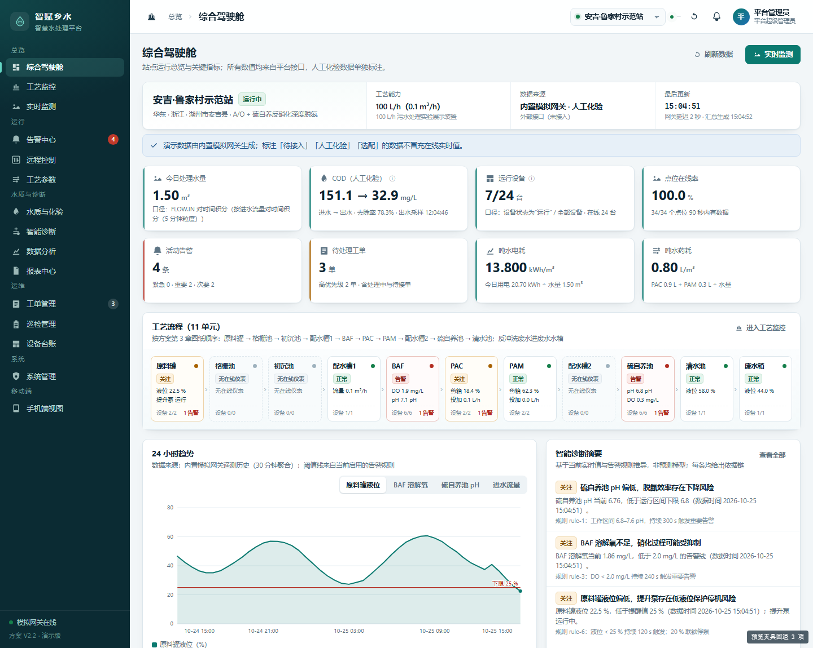
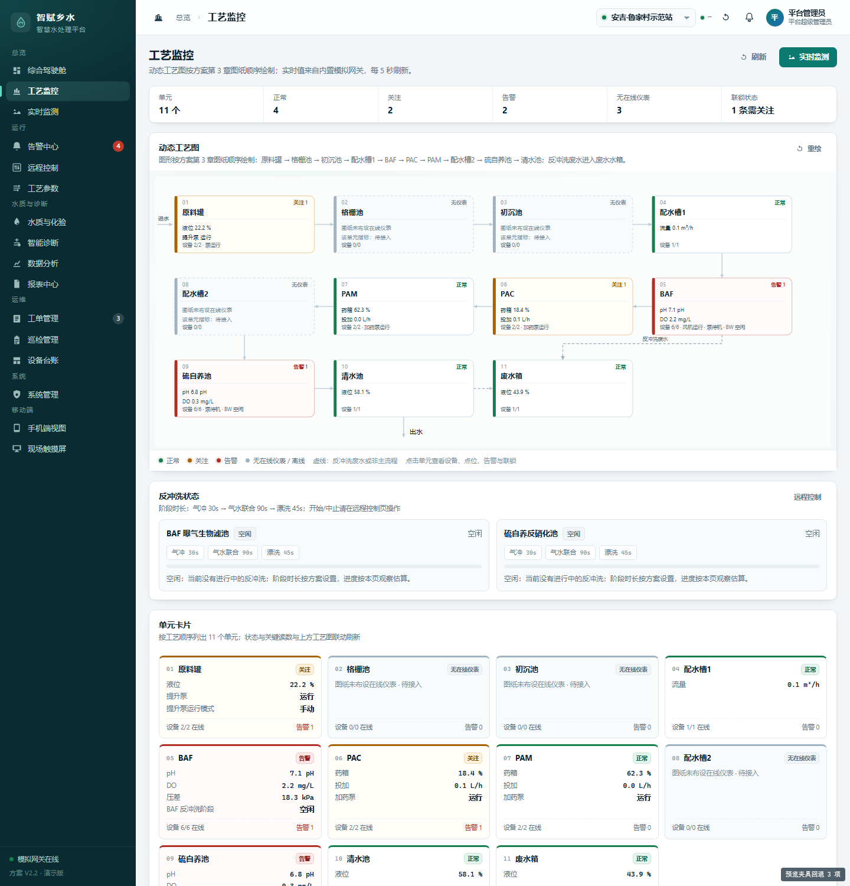
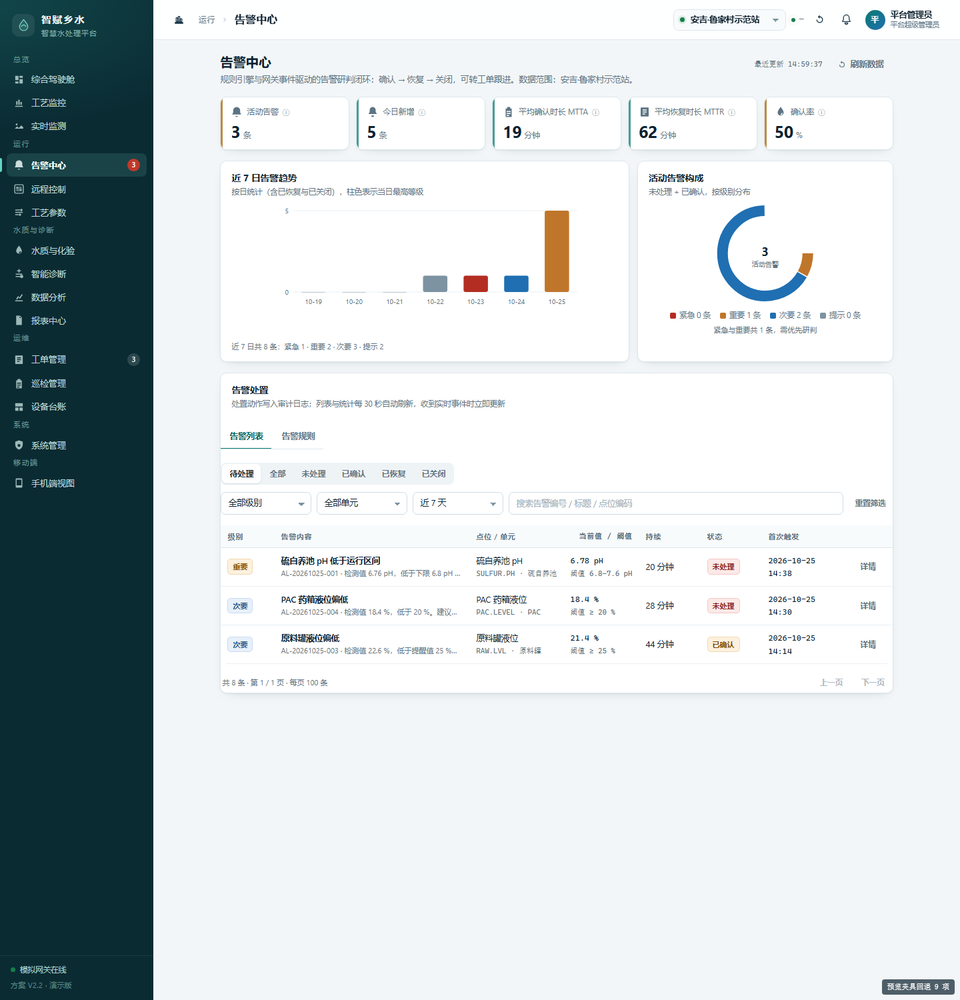
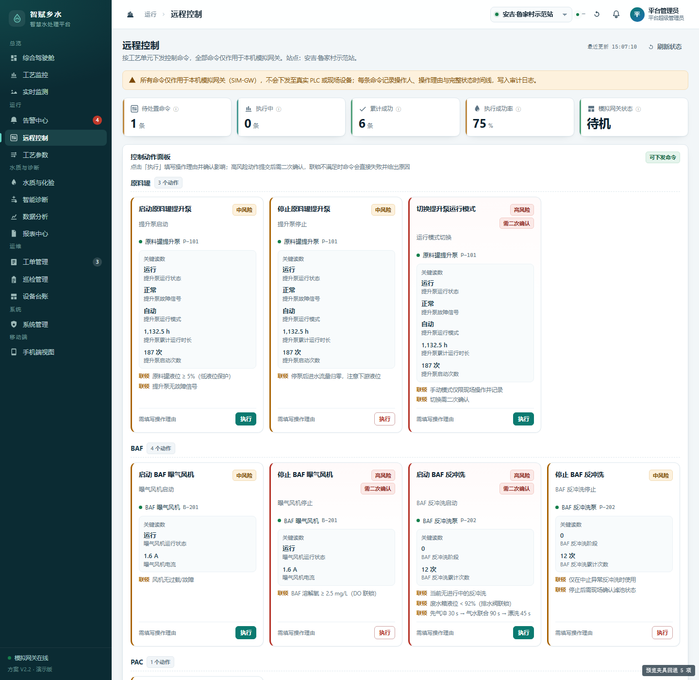
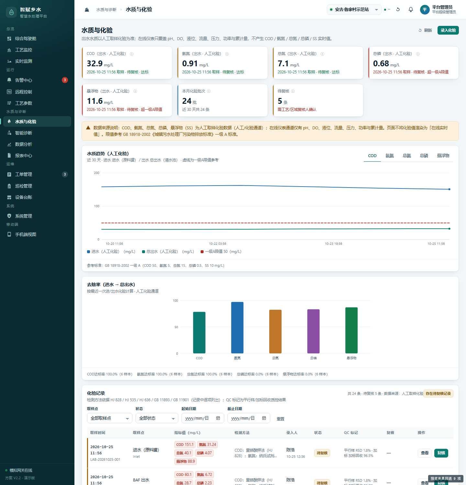
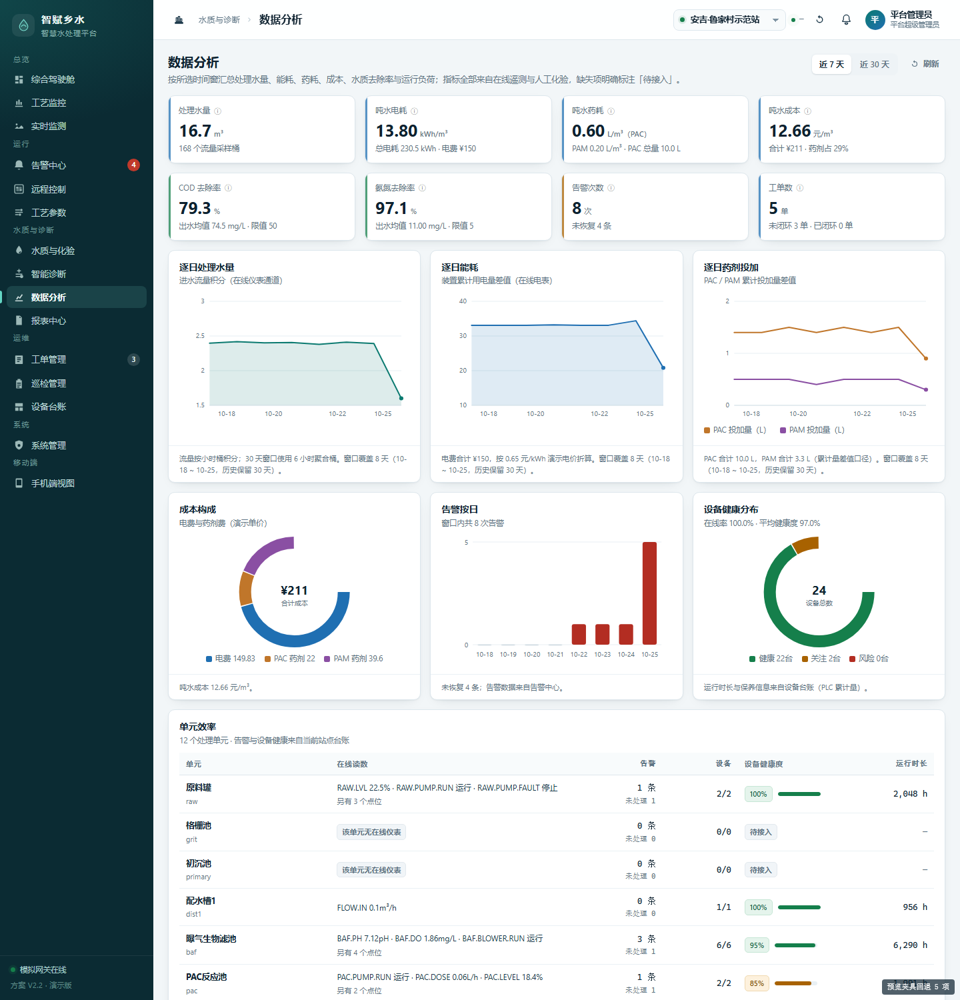
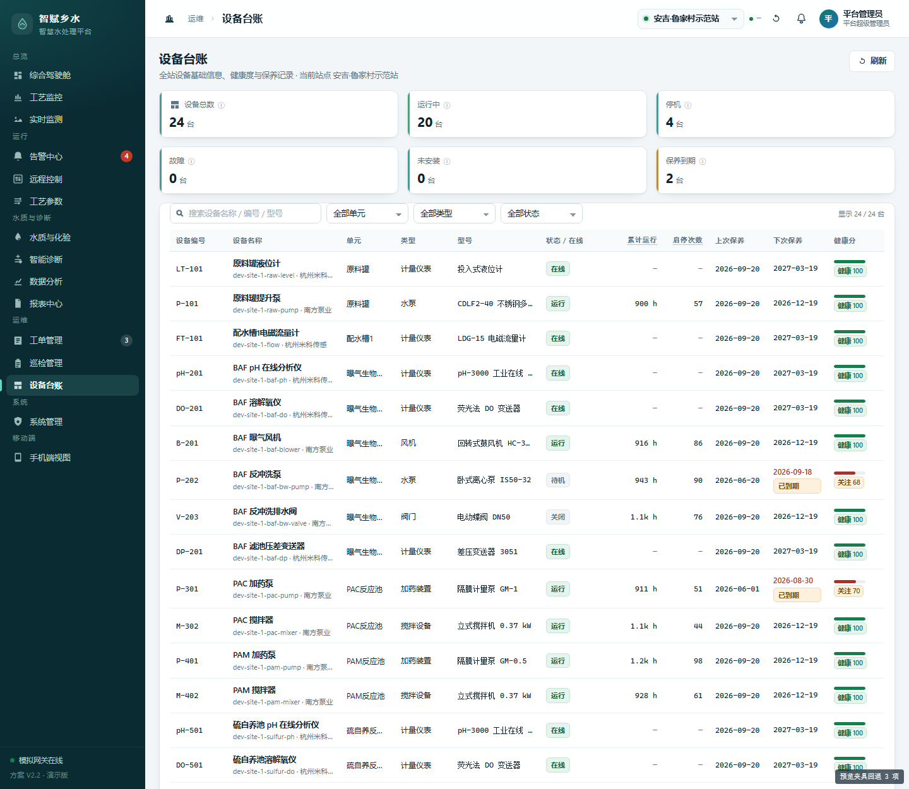
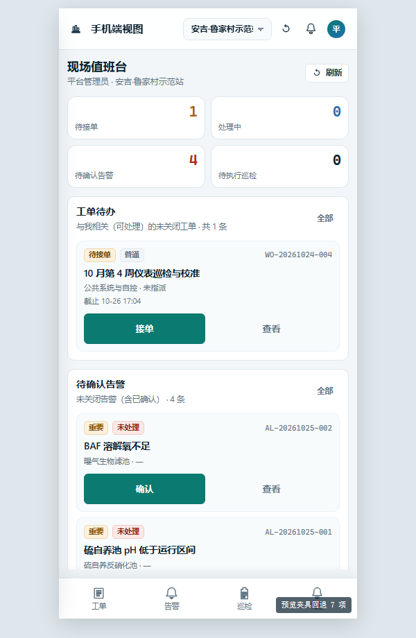
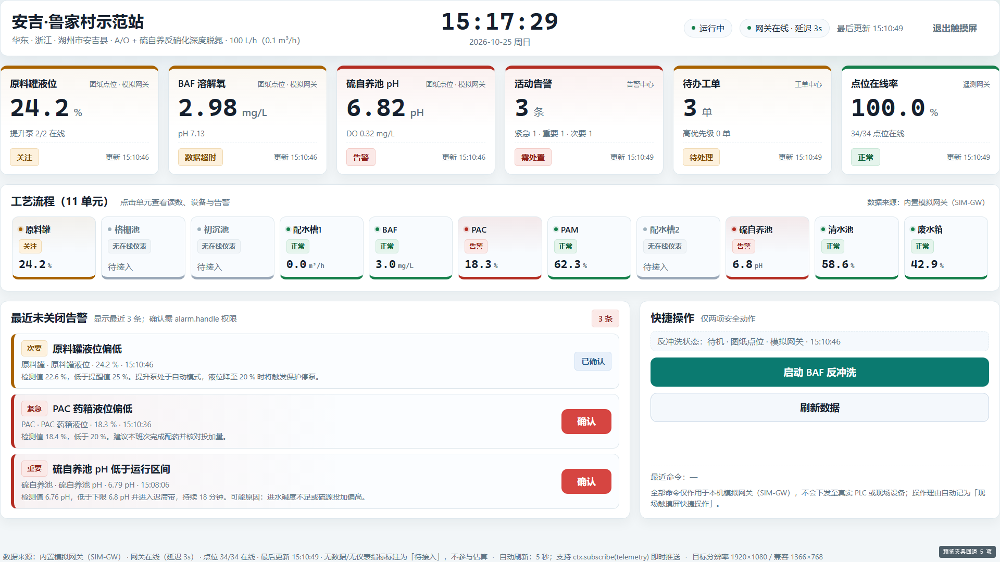
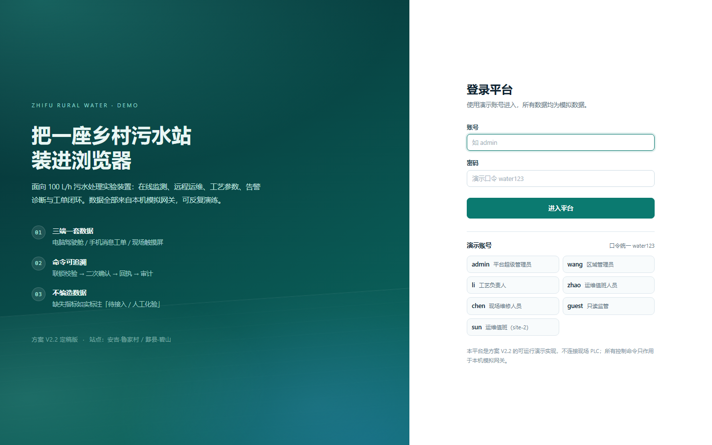

# 智赋乡水 · 智慧水处理平台（可运行演示版）

面向 **100 L/h 污水处理实验展示装置** 的智能监测、远程运维与工艺数据平台，按《智赋乡水_智慧水处理平台建设方案_V2.2_定稿版》实现。

- **云边端一体的最小可运行闭环**：平台服务 + 模拟网关/PLC + 浏览器三端界面。
- **单站先落地、多站可复制**：内置 2 个站点（安吉·鲁家村示范站、黟县·碧山复制试点站），其中 2 号站为精简复制版。
- **零外部依赖**：只用 Node.js 标准库与本机文件存储，不联网、不装数据库，解压目录即可运行。
- **数据有来源**：所有实时值标注来源与数据时间；无仪表、无在线分析的指标一律标「待接入 / 人工化验」，不做假数据。
- **三种用法**：源码直接运行（Web 版） / Windows 桌面安装包（内置服务，双击即用） / 原生安卓 App（Java 编写，直连平台 API）。

### 下载

| 端 | 安装包 | 说明 |
| --- | --- | --- |
| Windows 桌面版 | [`ZhifuWater-Setup-1.0.2.exe`](https://github.com/LN334/shuiwu/releases/download/v1.0.2/ZhifuWater-Setup-1.0.2.exe)（106 MB） | Electron 桌面程序，安装后自带服务与界面，无需另装 Node.js |
| 安卓 App | [`zhifu-water-mobile.apk`](https://github.com/LN334/shuiwu/releases/download/v1.0.2/zhifu-water-mobile.apk)（106 KB） | 原生 Android（Java + 框架 API，**非 WebView**），连接同一局域网内的平台服务 |
| Web 版 | 本仓库源码 | `node server/index.js`，浏览器打开 `http://127.0.0.1:8765` |

> 全部版本与校验值见 [Releases · v1.0.2](https://github.com/LN334/shuiwu/releases/tag/v1.0.2)；仓库内不提交二进制产物（见 `.gitignore`），也可按下面「构建」章节自行打包。

---

## 一、快速开始

### 环境要求

| 项目 | 要求 |
| --- | --- |
| 操作系统 | Windows 10/11、macOS、Linux 均可 |
| Node.js | **18 及以上**（实测 v24.19.0） |
| 浏览器 | Chrome / Edge / Firefox 等现代浏览器 |
| 依赖 | **无**。不需要 `npm install`，不需要数据库 |

### 方式一：源码直接运行（Web 版）

在本目录打开终端（Windows 可在地址栏输入 `cmd` 回车），执行：

```bash
node server/index.js
```

看到下面的横幅即启动成功：

```
智赋乡水 · 智慧水处理平台 v1.0.2
  本机访问: http://127.0.0.1:8765
  演示账号: admin / water123
```

浏览器打开 **http://127.0.0.1:8765**，用演示账号登录。

> **Windows 一键启动**：也可以直接双击本目录下的 `启动平台.bat`，它会检查 Node.js、启动服务并自动打开浏览器；关闭命令行窗口即停止服务。

### 常用命令

```bash
node server/index.js                    # 启动（默认 8765 端口，数据存 data/）
node server/index.js --port 9000        # 换端口
node server/index.js --reset            # 重置为初始演示数据（会覆盖 data/db.json）
node server/index.js --data D:/zf-data  # 指定数据目录
node scripts/smoke.js                   # 接口冒烟测试（需服务已启动）
node scripts/capture_fixtures.js        # 抓取接口快照，供离线预览使用
node scripts/build_preview.js           # 生成离线静态预览页（视觉核验用）
```

### 演示账号

| 账号 | 姓名 | 角色 | 数据范围 | 口令 |
| --- | --- | --- | --- | --- |
| `admin` | 平台管理员 | 平台超级管理员 | 全部站点 | `water123` |
| `wang` | 王敏 | 区域管理员 | 全部站点 | `water123` |
| `li` | 李工 | 工艺负责人 | 1 号站（site-1） | `water123` |
| `zhao` | 赵磊 | 运维值班人员 | 1 号站（site-1） | `water123` |
| `chen` | 陈浩 | 现场维修人员 | 全部站点 | `water123` |
| `guest` | 监管访客 | 只读监管 | 1 号站（site-1） | `water123` |
| `sun` | 孙倩 | 运维值班人员 | **仅 2 号站** | `water123` |
| `zhou` | 周涛 | （已停用） | 2 号站 | `water123` |

> 登录页可直接点选演示账号填入；口令统一为 `water123`。平台刻意保留 `sun`（仅 2 号站）与 `zhou`（停用）两个账号，用于演示「数据范围隔离」与「账号状态校验」。
> 也可用 `http://127.0.0.1:8765/?as=admin` 免登录进入（仅演示用）。

### 方式二：Windows 桌面版（推荐给不装环境的电脑）

1. 下载 Release 中的 `ZhifuWater-Setup-1.0.2.exe`，双击安装（可选择安装目录、创建桌面快捷方式）。
2. 从桌面「智赋乡水 · 智慧水处理平台」启动。程序会在本机随机空闲端口拉起平台服务，再用内置窗口打开界面，**不需要安装 Node.js**。
3. 运行数据保存在 `%APPDATA%\zhifu-water-desktop\data`，卸载程序不会自动删除该目录。

高级参数（在命令行或快捷方式目标后追加）：

```bash
"智赋乡水.exe" --kiosk        # 以现场触摸屏全屏界面启动（1920×1080）
"智赋乡水.exe" --smoke        # 自检：启动服务、打印 SMOKE_OK 后退出
"智赋乡水.exe" --enable-gpu   # 恢复硬件加速（默认关闭，见下）
```

> **黑屏说明**：部分老旧或双显卡笔记本在 Electron 的 GPU 合成下会出现「窗口全黑、只剩任务栏」。v1.0.2 起桌面端**默认关闭硬件加速**、改走软件渲染，并在 `%APPDATA%\zhifu-water-desktop\logs\startup.log` 记录 GPU 状态与加载错误；若仍遇到黑屏，可用菜单「应用 → 以兼容模式重启」或在快捷方式目标后加 `--disable-gpu`。

### 方式三：安卓 App（原生）

1. 下载 Release 中的 `zhifu-water-mobile.apk`，在手机上允许「安装未知来源应用」后安装。
2. 保证手机与运行平台的电脑在**同一局域网**，在 App 登录页填写服务器地址，例如 `http://192.168.1.20:8765`（电脑端 `ipconfig` 可查 IPv4）。
3. 用 `admin / water123` 登录。底部 5 个 Tab：总览、告警、工单、巡检、我的。

> 说明：安卓端是**完全原生**的 Java 客户端（Activity + 框架 View + HttpURLConnection + JSON），不使用 WebView、Gradle、androidx 或任何第三方库；只调用平台公开的 REST 接口，与 Web 端共用同一套账号、权限与数据。首次启动会提示允许明文 HTTP（局域网演示环境）。

### 构建（可选）

```bash
# 桌面安装包（Windows，需 Node.js 18+）
cd desktop
npm install
npm run dist            # 产物：desktop/dist/ZhifuWater-Setup-1.0.2.exe

# 安卓 APK（需 JDK 17 + Android SDK build-tools/platform 34）
cd android
powershell -ExecutionPolicy Bypass -File build.ps1
# 产物：android/dist/zhifu-water-mobile.apk
```

构建脚本会把 `server/` 与 `web/` 复制进桌面安装包；安卓端只编译 Java 源码，不打包网页资源。

---

## 二、按方案实现的功能

| 方案章节 | 平台落地 |
| --- | --- |
| 综合驾驶舱 | 站点概况、8 项 KPI（水量 / 进出水 COD / 运行设备 / 点位在线率 / 活动告警 / 待处理工单 / 吨水电耗 / 吨水药耗）、11 单元工艺链路、24h 趋势、活动告警、待办工单、诊断摘要、数据健康 |
| 站点/设备/点位管理 | 2 站点、24 台设备台账（运行/停机/故障/未安装、运行小时、保养周期）、33 个点位（含图纸实测点与选配点标记） |
| 实时监测与动态工艺图 | 5 秒刷新实时值、单位与来源、超时标灰；工艺图显示单元状态、泵/风机/反冲洗状态与联锁 |
| 水质与化验 | 在线 pH/DO/液位/流量与**人工化验**双来源分离；化验录入、复核（通过/驳回）、QC 标记、去除率与达标判定（参考 GB 18918 一级 A） |
| 工艺参数与配方 | 12 个参数、三类写入模式（云端直接 / 审批 / 现场设定）、版本历史与回滚、审批（禁止自审） |
| 远程控制中心 | 11 个动作、命令状态机（待确认→待下发→已下发→执行中→成功/失败/超时/取消）、PLC 联锁校验、执行理由、回执与审计 |
| 智能告警中心 | 15 条规则（阈值+持续时长+迟滞+升级+联锁条件）、四级告警、确认/恢复/关闭、MTTA/MTTR 统计 |
| 智能诊断 | 现象—可能原因—检查项—边界—依据（点位/趋势/规则/数据时间）—建议，7 类诊断模型 |
| 数据分析 | 水量、能耗、药耗、成本、去除率、单元效率、设备健康、告警统计（7/30 天） |
| 工单与巡检 | 工单状态机（待接单→已接单→处理中→待验收→已验收→已关闭）、超时标记、巡检计划与任务、异常自动转工单 |
| 设备全生命周期 | 台账、运行小时、保养到期、保养记录、健康分 |
| 报表中心 | 5 类报表、服务端生成、CSV 导出（UTF-8 BOM，Excel 可直接打开） |
| 系统管理 | 用户/角色/设置/通知通道/审计日志/备份与恢复 |
| 权限与数据范围 | 6 角色 × 功能权限，站点范围双重校验；服务端拒绝越权（前端仅做展示层禁用） |
| 手机端 | `#/mobile` 现场工作台：我的工单、待确认告警、今日巡检、消息；桌面端自动呈现手机宽度预览 |
| 现场触摸屏 | `#/kiosk` 大字值守界面（1920×1080 / 1366×768）：站点状态、6 项关键读数、11 单元工艺链、最近告警一键确认、BAF 反冲洗快捷操作，5 秒自动刷新 |
| 三端一屏 | 电脑驾驶舱 / 手机消息工单 / 现场触摸屏共用一套接口与数据 |

---

## 三、数据边界（重要）

平台严格遵守方案的「不伪造数据」原则：

1. **有在线仪表的**：原料罐液位、提升泵状态/运行小时、进水流量（选配）、BAF 与硫自养池 pH/DO、曝气风机电流、反冲洗状态、PAC/PAM 药箱液位与投加量、清水池/废水箱液位、功率与电能。这些值由内置**模拟网关**按工艺机理每 5 秒生成并写入遥测库。
2. **图纸未确认的表计**：进水流量计、TN/COD/氨氮/总磷/SS 在线分析仪一律标 `provenance: optional` 或 `待接入`，界面不显示实时值。
3. **人工化验**：COD、氨氮、总氮、总磷、SS 由 `#/quality` 录入，状态为「待复核 / 已复核 / 已驳回」，并标注方法与取样点；驾驶舱引用时显示 `人工化验 · 时间`。
4. **模拟网关**：`server/sim.js` 是确定性工艺模型（可复现随机种子），**不连接现场 PLC**。所有远程控制只作用于该模拟网关，命令的联锁、回执、超时、审计均为真实服务端逻辑。
5. **试运行承诺**：方案第 15 章的「连续试运行 ≥ 30 天」「数据接入成功率 ≥ 99%」需现场部署后验证，本演示版不承诺。
6. **演示数据的量级说明（避免误读）**：装置处理能力 100 L/h（0.1 m³/h），按连续运行折算约 **2.4 m³/日**；内置遥测保留 **30 天**（最近 24 小时 5 分钟粒度，更早为 1 小时粒度）。
   - 药剂投加设定：PAC **0.06 L/h**、PAM **0.02 L/h**，折算吨水药耗约 **0.60 / 0.20 L/m³**；
   - 吨水电耗约 **13.8 kWh/m³**——这是小型实验装置按 0.1 m³/h 折算的真实量级（搅拌器、风机、加药泵长期运行，水量却很小），**明显高于常规市政污水厂 0.3–0.5 kWh/m³**，不代表工艺落后；
   - 吨水成本约 **12.7 元/m³**：电费按 0.65 元/kWh、PAC 2.2 元/L、PAM 12 元/L 的**演示单价**估算，仅用于趋势对比，不作为结算依据。

---

## 四、与方案推荐技术栈的差异

方案第 10 章建议 Vue3 + TypeScript + ECharts + Spring Boot + MySQL/PostgreSQL + MQTT + Docker。本演示环境无外网 npm 源、且使用者不写代码，因此改为：

| 方案建议 | 本实现 | 原因与影响 |
| --- | --- | --- |
| Spring Boot 后端 | Node.js 标准库 HTTP 服务 | 零依赖、双击即跑；接口分层与数据模型仍按方案第 8 章组织，可平移 |
| MySQL/PostgreSQL | JSON 文件存储（`data/db.json`，原子写入 + 备份） | 单站演示足够；数据层已隔离在 `server/store.js`，替换数据库不影响业务代码 |
| Vue3 + ECharts | 原生 ES Module + 内联 SVG 图表 | 无构建步骤、无 CDN；图表组件在 `web/js/ui.js`，可替换 |
| MQTT | 内置模拟网关 + WebSocket 推送 | 保留「网关 → 平台 → 浏览器」三层链路；接入真实 MQTT 只需替换 `server/sim.js` |
| Docker | 直接 `node server/index.js` | 单文件部署更简单；需要容器化时加一个 `Dockerfile` 即可 |
| Java 权限框架 | 服务端 `Auth` + 角色权限表 | 功能权限 + 站点范围双重校验，越权返回 403 |

---

## 五、目录结构

```
zhifu-water-platform/
├── server/
│   ├── index.js          服务入口：装配、路由、静态服务、WebSocket、启动模拟网关
│   ├── http.js           零依赖 HTTP 工具（Router / 静态服务 / WS Hub）
│   ├── store.js          JSON 存储（原子写、防抖、迁移、备份）
│   ├── auth.js           登录、会话、权限、数据范围
│   ├── telemetry.js      遥测存储（最新值 + 30 天历史）
│   ├── sim.js            模拟网关与工艺模型（联锁、反冲洗时序、加药）
│   ├── rules.js          告警规则引擎（持续时长、迟滞、升级、恢复）
│   ├── commands.js       命令状态机（联锁、确认、回执、超时、审计）
│   ├── diagnosis.js      智能诊断模型
│   ├── analytics.js      指标派生（在线率、水量积分、单元状态、设备健康）
│   ├── notify.js         站内通知与通道
│   ├── audit.js          审计日志
│   ├── seed/             演示数据（资产、运维、平台设置）
│   └── api/              接口层：auth / overview / alarms / control / ops / analysis
├── web/
│   ├── index.html        单页外壳（登录、侧栏、顶栏、弹窗容器）
│   ├── css/              设计令牌与组件样式、各页面样式
│   └── js/               api 客户端、UI 组件库、路由外壳、16 个页面模块（含现场触摸屏）
├── scripts/              冒烟测试、接口快照、离线预览构建
├── desktop/              Windows 桌面版（Electron 主进程 + 打包脚本 + 图标）
├── android/              原生安卓 App（Java 源码 + 手工打包脚本，无 Gradle）
├── docs/CONTRACT.md      接口与页面模块契约
├── docs/screenshots/     16 个页面的验收截图
├── data/db.json          运行数据（首次启动自动生成）
└── package.json
```

---

## 六、接口与联调

- 统一响应：`{ "ok": true, "data": ..., "meta": ... }` 或 `{ "ok": false, "error": { "code", "message", "details" } }`。
- 认证：`POST /api/auth/login` 设置 HttpOnly Cookie `zfs_session`，同时返回 token；也支持 `Authorization: Bearer <token>`。
- 实时：`ws://<host>/ws` 推送 `telemetry / alarm / command / workorder / param / notification` 事件。
- 完整分组、字段与页面模块契约见 [`docs/CONTRACT.md`](docs/CONTRACT.md)。

冒烟测试（78 项，覆盖登录、权限隔离、跨站越权、命令状态机、参数审批、工单闭环、巡检、化验复核、报表导出、备份恢复）：

```bash
node scripts/smoke.js
# SMOKE total=78 failures=0 rate=100%
```

---

## 七、数据重置与备份

- **重置**：`node server/index.js --reset` 或删除 `data/db.json` 后重启。
- **在线备份**：`#/admin` → 备份 → 新建备份，会生成 `data/backups/*.json`；恢复前自动保存回滚点。
- **注意**：恢复备份会使当前所有登录会话失效，需要重新登录（这是有意的安全设计）。
- 平台写入采用「临时文件 + 原子重命名」，异常断电不会产生半截 JSON；但生产环境仍建议按方案第 14 章做数据库级备份。

---

## 八、已知限制

1. 模拟网关按 5 秒节拍生成数据，历史保留 30 天（最近 24 小时按 5 分钟落桶，更早按 1 小时落桶）；生产需改为实时库 + 时序库。
2. 文件存储在单机、单进程下可靠；多实例并发写需改用数据库。
3. 报表 CSV 为 UTF-8 BOM 编码，适合 Excel；正式报表模板（Word/PDF）需按方案第 11 章扩展。
4. 通知通道为「模拟发送」（站内通知必达，短信/微信/邮件记录发送结果），接入真实通道需配置供应商密钥。
5. 手机端有两种形态：Web 端 `#/mobile` 响应式工作台，以及 Release 中的原生安卓 App；两者都要求能访问平台服务（同一局域网）。Web 版未做离线缓存，断网补传在方案中属现场边缘网关职责。
6. 桌面版使用 Electron 内置窗口，未做自动更新（electron-updater）；升级需下载新安装包覆盖安装。
7. 本平台是方案 V2.2 的**演示实现**，用于评审、演示与后续开发的基线，不替代现场 PLC 安全联锁。

---

## 八、界面预览

| | |
| --- | --- |
|  |  |
| 综合驾驶舱 | 工艺监控（11 单元工艺图） |
|  |  |
| 告警中心 | 远程控制（命令状态机） |
|  |  |
| 水质与化验（人工化验通道） | 数据分析 |
|  |  |
| 设备台账 | 手机工作台（Web 端 430px） |
|  |  |
| 现场触摸屏（1920×1080） | 登录页 |

其余页面截图见 [`docs/screenshots/`](docs/screenshots)。

---

## 九、方案对应关系

- 方案原文：`智赋乡水_智慧水处理平台建设方案_V2.2_定稿版.docx`
- 工艺基准：11 单元顺序（原料罐 → 格栅池 → 初沉池 → 配水槽 1 → BAF → PAC 反应池 → PAM 反应池 → 配水槽 2 → 硫自养反硝化池 → 清水池 → 废水水箱）。
- 页面结构、权限矩阵、告警分级、命令状态机、验收指标均按方案第 4/5/8/9/13/15 章落地。
