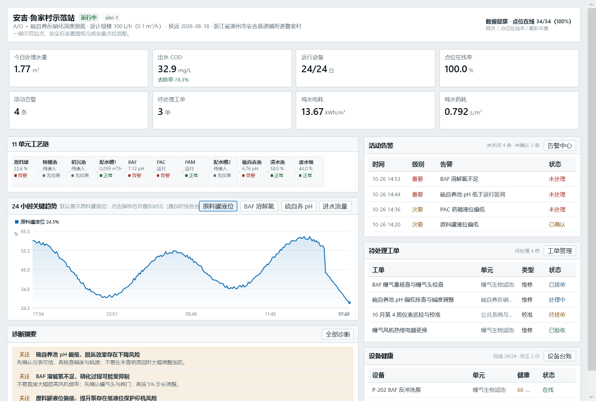
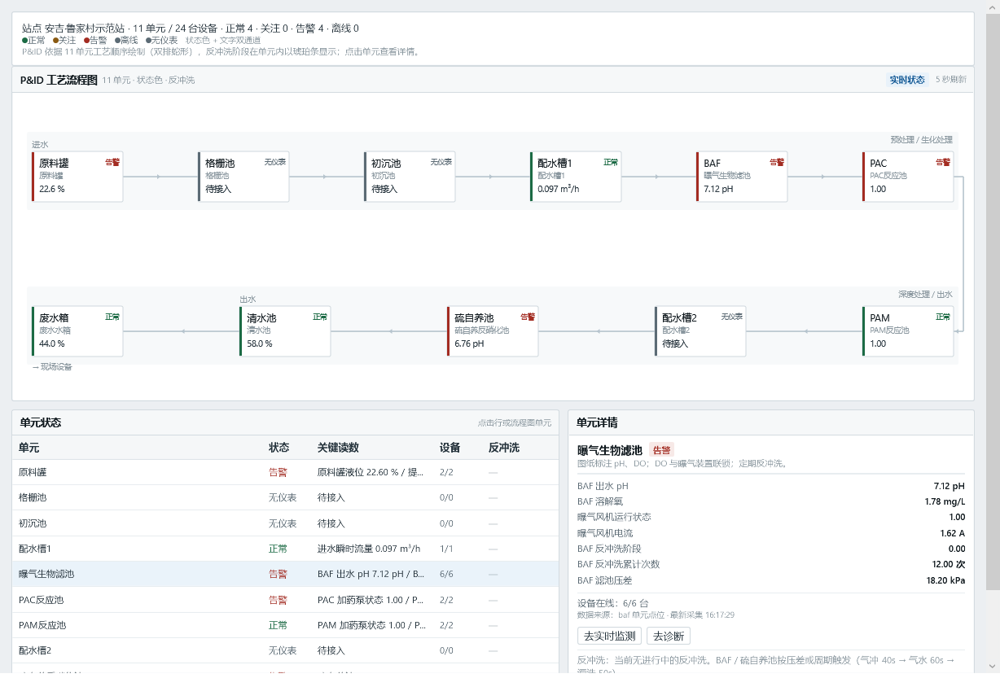
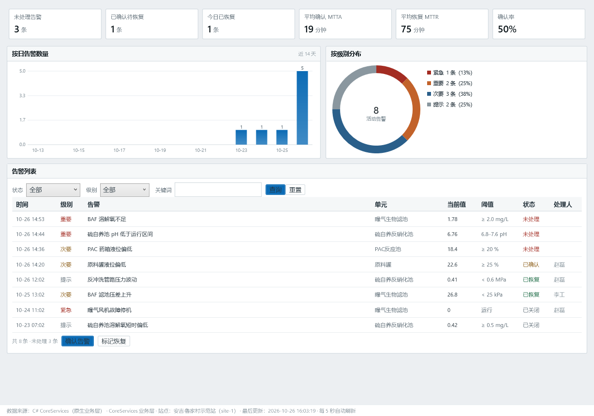
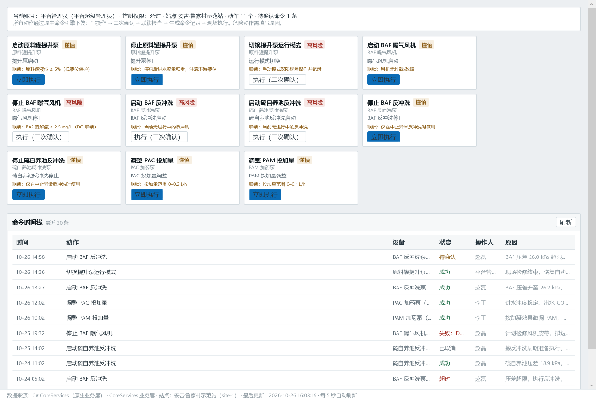
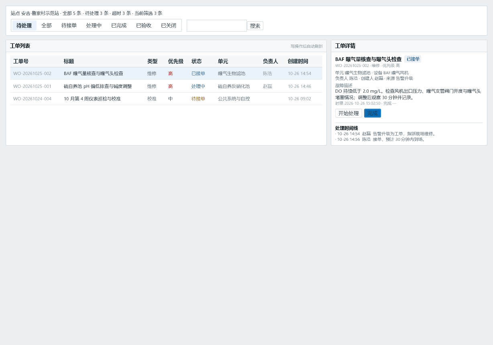
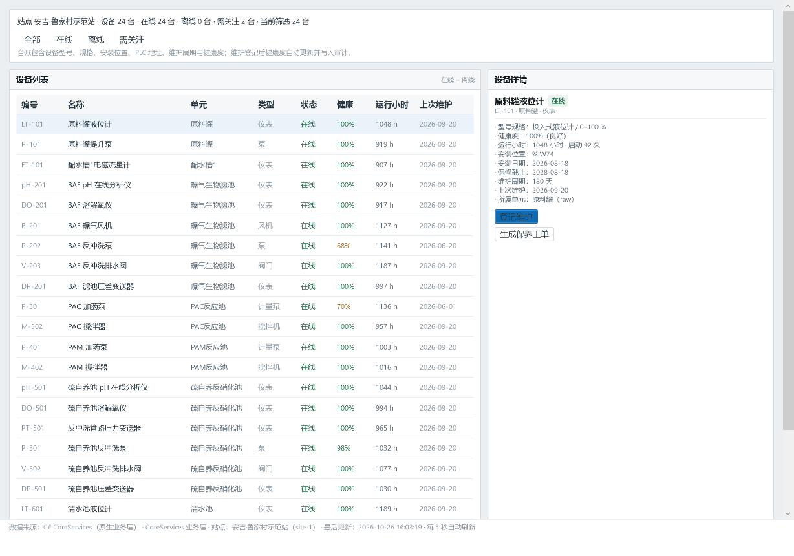
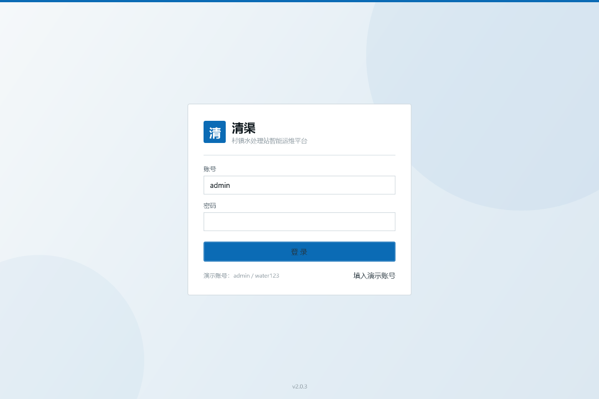
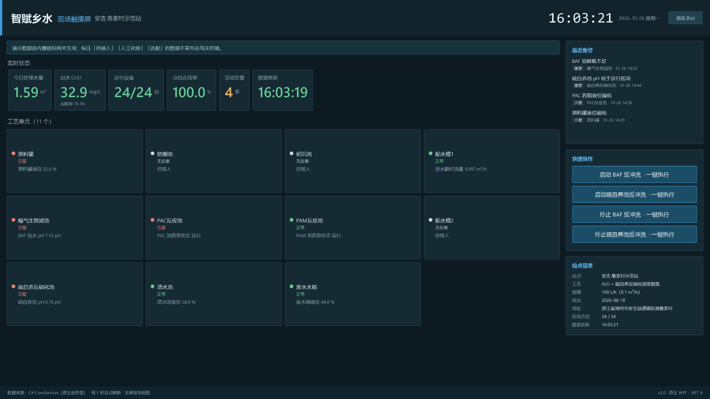

# 清渠 · 村镇水处理站智能运维平台

村镇污水站通常只有一两个人值守：工艺靠经验、异常靠电话、台账靠纸。清渠把这些事搬进一套装在自己电脑和手机上的软件——实时看工艺、异常先报警、处置留痕迹、数据可追溯。

v2 起提供两个**原生 App**，装完即用：

- **Windows 桌面端**：C# / .NET 8 / WPF 原生窗口，业务层与数据都在本机，不依赖浏览器、Node.js 或服务器。
- **安卓 App**：Java + 框架控件 + SQLite，内置本机引擎，**不连电脑也能独立运行**；也可以连平台服务看同一份数据。
- 仓库中保留 Web 版（`server/` + `web/`），供浏览器访问与二次开发。

### 它管什么

- **一座站的完整工艺链**：原料罐 → 格栅池 → 初沉池 → 配水槽 1 → BAF → PAC → PAM → 配水槽 2 → 硫自养反硝化池 → 清水池 → 废水箱，液位、pH、DO、流量、压差、加药、反冲洗每 5 秒刷新。
- **异常先于人来**：阈值 + 持续时长 + 迟滞 + 升级的四级告警；确认、恢复、关闭全程留痕，附带 MTTA / MTTR。
- **处置闭环**：告警或巡检异常可一键转工单，接单 → 处理 → 验收 → 关闭，责任人和时间都记录在案。
- **数据有出处**：在线仪表与人工化验分开展示，没有的仪表明确标「待接入」，不拿估算值冒充实测。
- **权限到站点**：6 类角色 + 站点数据范围双重校验，越界由业务层拒绝，而不是只在界面上藏按钮。

### 下载

| 端 | 安装包 | 说明 |
| --- | --- | --- |
| Windows 桌面版 | [`Qingqu-Setup-2.0.6.exe`](https://github.com/LN334/qingqu/releases/download/v2.0.6/Qingqu-Setup-2.0.6.exe)（约 46 MB） | C# / WPF 原生程序，自包含 .NET 运行时，安装即用 |
| 安卓 App | [`zhifu-water-mobile.apk`](https://github.com/LN334/qingqu/releases/download/v2.0.6/zhifu-water-mobile.apk)（约 155 KB） | 原生 Android（Java + 框架 API，非 WebView）；不填服务器也能用 |
| Web 版 | 本仓库源码 | `node server/index.js`，浏览器打开 `http://127.0.0.1:8765` |

> 全部版本与 SHA256 见 [Releases · v2.0.6](https://github.com/LN334/qingqu/releases/tag/v2.0.6)。仓库不提交二进制产物，也可按「构建」章节自行打包。

---

## 一、快速开始

### 方式一：Windows 桌面版（推荐）

1. 下载 `Qingqu-Setup-2.0.6.exe`，双击安装（可选择安装目录、创建桌面与开始菜单快捷方式）。
2. 从桌面「清渠」启动。原生窗口，不需要浏览器、不需要 Node.js。
3. 用演示账号登录；首次启动会把内置种子数据复制到 `%LOCALAPPDATA%\ZhifuWater\data\db.json`，之后的数据读写都在本机。

> 卸载程序会移除安装目录与快捷方式，但**不会删除** `%LOCALAPPDATA%\ZhifuWater` 下的数据；需要清空时手动删除该目录即可。

### 方式二：安卓 App（原生、可离线）

1. 下载 `zhifu-water-mobile.apk`，在手机上允许「安装未知来源应用」后安装。
2. 打开 App，点「**直接进入（本机演示）**」——不需要电脑、不需要填服务器地址。
   数据存在手机本地 SQLite，本机引擎每 5 秒推进一次，会自己产生趋势和告警，确认告警、流转工单、提交巡检都会保存。
3. 如果想看电脑上的真实数据：在登录页展开「连接服务器」，填 `http://电脑IP:8765`，用同一套账号登录。

> App 是**完全原生**的 Java 实现（Activity + 框架 View + SQLite，无 WebView、无 Gradle、无 androidx、无第三方库）。本机模式下数据仅存在手机上，与电脑端互不影响。

### 方式三：Web 版（开发/演示）

```bash
node server/index.js
```

浏览器打开 **http://127.0.0.1:8765**（需 Node.js 18+，无其他依赖）。Windows 也可双击 `启动平台.bat`。

Web 端与桌面端同为 2.0.6：品牌、浅色水务蓝界面、数据模型一致；现场触摸屏入口不在侧栏，直接访问 `http://127.0.0.1:8765/#/kiosk` 进入全屏视图。

### 演示账号

| 账号 | 姓名 | 角色 | 数据范围 | 口令 |
| --- | --- | --- | --- | --- |
| `admin` | 平台管理员 | 平台超级管理员 | 全部站点 | `water123` |
| `wang` | 王敏 | 区域管理员 | 全部站点 | `water123` |
| `li` | 李工 | 工艺负责人 | 1 号站（site-1） | `water123` |
| `zhao` | 赵磊 | 运维值班人员 | 1 号站（site-1） | `water123` |
| `chen` | 陈浩 | 现场维修人员 | 全部站点 | `water123` |
| `guest` | 监管访客 | 只读监管 | 1 号站（site-1） | `water123` |
| `sun` | 孙倩 | 运维值班人员 | **仅 2 号站** | `water123` |
| `zhou` | 周涛 | （已停用） | 2 号站 | `water123` |

> 桌面端登录页可一键填入 `admin`；Web 端登录页有演示账号折叠区。`sun`（仅 2 号站）与 `zhou`（停用）用于演示数据范围隔离与账号状态校验。

---

## 二、功能一览

| 方案章节 | 平台落地 |
| --- | --- |
| 综合驾驶舱 | 站点概况、8 项 KPI（水量 / 进出水 COD / 运行设备 / 点位在线率 / 活动告警 / 待处理工单 / 吨水电耗 / 吨水药耗）、11 单元工艺链、24h 趋势、活动告警、待办工单、诊断摘要、数据健康 |
| 站点/设备/点位管理 | 2 站点、24 台设备台账（运行/停机/故障/未安装、运行小时、保养周期）、33 个点位（含图纸实测点与选配点标记） |
| 实时监测与动态工艺图 | 5 秒刷新实时值、单位与来源、超时标灰；工艺图显示单元状态、泵/风机/反冲洗状态与联锁 |
| 水质与化验 | 在线 pH/DO/液位/流量与**人工化验**双来源分离；化验录入、复核（通过/驳回）、QC 标记、去除率与达标判定（参考 GB 18918 一级 A） |
| 工艺参数与配方 | 12 个参数、三类写入模式（云端直接 / 审批 / 现场设定）、版本历史与回滚、审批（禁止自审） |
| 远程控制中心 | 11 个动作、命令状态机（待确认→待下发→已下发→执行中→成功/失败/超时/取消）、PLC 联锁校验、执行理由、回执与审计 |
| 智能告警中心 | 15 条规则（阈值+持续时长+迟滞+升级+联锁条件）、四级告警、确认/恢复/关闭、MTTA/MTTR 统计 |
| 智能诊断 | 现象—可能原因—检查项—边界—依据（点位/趋势/规则/数据时间）—建议，7 类诊断模型 |
| 数据分析 | 水量、能耗、药耗、成本、去除率、单元效率、设备健康、告警统计（7/30 天） |
| 工单与巡检 | 工单状态机（待接单→已接单→处理中→待验收→已验收→已关闭）、超时标记、巡检计划与任务、异常自动转工单 |
| 设备全生命周期 | 台账、运行小时、保养到期、保养记录、健康分 |
| 报表中心 | 5 类报表、服务端生成、CSV 导出（UTF-8 BOM，Excel 可直接打开） |
| 系统管理 | 用户/角色/设置/通知通道/审计日志/备份与恢复 |
| 权限与数据范围 | 6 角色 × 功能权限，站点范围双重校验；业务层拒绝越权（界面只做展示层禁用） |
| 安卓 App | 原生 5 Tab（总览 / 告警 / 工单 / 巡检 / 我的），本机 SQLite + 5 秒实时引擎，可离线；也可连服务器 |
| 现场触摸屏（独立模式） | 给现场机器用的全屏大字值守界面（1920×1080 / 1366×768），**不在电脑端侧栏里**；用 `Qingqu.exe --kiosk` 启动：站点状态、6 项关键读数、11 单元工艺链、告警一键确认、BAF 反冲洗快捷操作，5 秒自动刷新 |
| 多端同源 | 桌面端与安卓端共用同一套业务规则与数据模型（桌面 C# Core、安卓 LocalCore 各自移植），Web 端可作为服务端 |

---

## 三、数据边界（重要）

平台严格遵守方案的「不伪造数据」原则：

1. **有在线仪表的**：原料罐液位、提升泵状态/运行小时、进水流量（选配）、BAF 与硫自养池 pH/DO、曝气风机电流、反冲洗状态、PAC/PAM 药箱液位与投加量、清水池/废水箱液位、功率与电能。桌面端由内置 C# 模拟引擎、安卓端由本机引擎按工艺机理每 5 秒生成并写入本地库。
2. **图纸未确认的表计**：进水流量计、TN/COD/氨氮/总磷/SS 在线分析仪一律标 `provenance: optional` 或 `待接入`，界面不显示实时值。
3. **人工化验**：COD、氨氮、总氮、总磷、SS 由「水质与化验」录入，状态为「待复核 / 已复核 / 已驳回」，并标注方法与取样点；驾驶舱引用时显示 `人工化验 · 时间`。
4. **模拟引擎**：桌面端 `native/ZhifuWater.Core`（C#）与安卓端 `LocalEngine` 都是确定性工艺模型，**不连接现场 PLC**。所有远程控制只作用于模拟引擎，命令的联锁、回执、超时、审计均为真实业务逻辑。
5. **试运行承诺**：方案第 15 章的「连续试运行 ≥ 30 天」「数据接入成功率 ≥ 99%」需现场部署后验证，本演示版不承诺。
6. **演示数据的量级说明（避免误读）**：装置处理能力 100 L/h（0.1 m³/h），按连续运行折算约 **2.4 m³/日**；遥测保留 **30 天**（最近 24 小时 5 分钟粒度，更早为 1 小时粒度）。
   - 药剂投加设定：PAC **0.06 L/h**、PAM **0.02 L/h**，折算吨水药耗约 **0.60 / 0.20 L/m³**；
   - 吨水电耗约 **13.8 kWh/m³**——这是小型实验装置按 0.1 m³/h 折算的真实量级（搅拌器、风机、加药泵长期运行，水量却很小），**明显高于常规市政污水厂 0.3–0.5 kWh/m³**，不代表工艺落后；
   - 吨水成本约 **12.7 元/m³**：电费按 0.65 元/kWh、PAC 2.2 元/L、PAM 12 元/L 的**演示单价**估算，仅用于趋势对比，不作为结算依据。

---

## 四、技术选型与方案的差异

方案第 10 章建议 Vue3 + TypeScript + ECharts + Spring Boot + MySQL/PostgreSQL + MQTT + Docker。本机环境无法安装这些依赖，且目标是「双击即用」，因此实现如下：

| 方案建议 | 本实现 | 原因与影响 |
| --- | --- | --- |
| Spring Boot 后端 | **C# .NET 8 业务层**（`native/ZhifuWater.Core`）；Web 版另用 Node 标准库 | 桌面端单进程原生运行，不需要额外服务；接口与数据模型仍按方案第 8 章组织 |
| MySQL/PostgreSQL | JSON 文件存储（桌面 `%LOCALAPPDATA%\ZhifuWater\data\db.json`；安卓 SQLite） | 单站演示足够；数据访问已隔离在 Store/LocalDb，替换数据库不影响业务 |
| Vue3 + ECharts | **WPF XAML 原生控件 + 自绘图表**；Web 版为原生 ES Module + 内联 SVG | 无浏览器、无 CDN、无构建步骤 |
| MQTT | 内置 C# / Java 模拟引擎，5 秒节拍 | 保留「网关 → 平台 → 界面」链路；接真实 MQTT/Modbus 时替换引擎即可 |
| Docker | 桌面安装包 / APK 直接分发 | 单文件部署更简单 |
| Java 权限框架 | `Auth` + 角色权限表（C#/Node 各一份，规则一致） | 功能权限 + 站点范围双重校验，越界直接拒绝 |

---

## 五、目录结构

```
zhifu-water-platform/
├── native/                   桌面端（C# / .NET 8）
│   ├── ZhifuWater.Core/      业务层：存储、登录、遥测、模拟引擎、告警、命令、工单、报表
│   ├── ZhifuWater.Core.Tests/ 业务层自测（174 断言）
│   ├── ZhifuWater.Desktop/   WPF 界面：14 个页面 + 触摸屏独立窗口（--kiosk）
│   ├── installer/setup.nsi   NSIS 安装包脚本
│   └── seed/db.json          首次启动的种子数据
├── android/                  安卓端（Java，手工打包，无 Gradle）
│   ├── src/                  Activity / 页面 / LocalDb / LocalEngine / LocalApi
│   ├── assets/demo/          首次启动导入的种子数据
│   └── build.ps1             aapt2 → javac → d8 → zipalign → apksigner
├── server/                   Web 版 Node 服务（可选）
├── web/                      Web 版前端（可选）
├── desktop/                  旧 Electron 桌面版（v1.x 遗留，v2 不再发布）
├── scripts/                  Web 版冒烟测试、接口快照、离线预览
├── docs/screenshots/         截图（native/ 为 v2 原生桌面）
└── data/db.json              Web 版运行数据（首次启动自动生成）
```

---

## 六、构建

### 桌面端（需 .NET SDK 8）

```powershell
dotnet publish native\ZhifuWater.Desktop\ZhifuWater.Desktop.csproj -c Release -r win-x64 `
  --self-contained true -p:PublishSingleFile=true -p:IncludeNativeLibrariesForSelfExtract=true -o native\publish

# 自检（打印 DESKTOP-SMOKE OK pages=15 kiosk=11 即通过）
native\publish\Qingqu.exe --smoke

# 安装包（NSIS）
& "C:\Program Files (x86)\NSIS\makensis.exe" native\installer\setup.nsi
# 产物：native/installer/Qingqu-Setup-2.0.6.exe
```

### 安卓端（需 JDK 17 + Android SDK build-tools/platform 34）

```powershell
cd android
powershell -ExecutionPolicy Bypass -File build.ps1
# 产物：android/dist/zhifu-water-mobile.apk
```

### 业务层自测（C#）

```powershell
dotnet run --project native\ZhifuWater.Core.Tests -c Release
# CORE-TESTS PASS 174/174
```

### Web 版（可选）

```bash
node server/index.js
node scripts/smoke.js        # 78 项接口冒烟
```

---

## 七、已知限制

1. 模拟引擎按 5 秒节拍生成数据，历史保留 30 天（最近 24 小时按 5 分钟落桶，更早按 1 小时落桶）；生产需改为实时库 + 时序库。
2. 文件存储（桌面 JSON / 安卓 SQLite）在单机单进程下可靠；多实例并发写需改用数据库。
3. 报表 CSV 为 UTF-8 BOM 编码，适合 Excel；正式报表模板（Word/PDF）需按方案第 11 章扩展。
4. 通知通道为「模拟发送」（站内通知必达，短信/微信/邮件记录发送结果），接入真实通道需配置供应商密钥。
5. 桌面端为自包含单文件程序，启动时需解压运行时，首次打开约 2–4 秒；未做自动更新，升级需下载新安装包覆盖安装。
6. 安卓端本机模式的数据与告警由手机本地生成，与电脑端互不同步；需要同一份数据时改连服务器。当前构建未在真机上做过安装与触控验收（本机无安卓设备/模拟器），已完成编译、签名、包信息与逻辑自测。
7. 本平台是方案 V2.2 的**演示实现**，用于评审、演示与后续开发基线，不替代现场 PLC 安全联锁。

---

## 八、界面预览（v2 原生桌面）

| | |
| --- | --- |
|  |  |
| 综合驾驶舱 | 工艺监控（11 单元工艺图） |
|  |  |
| 告警中心 | 远程控制（命令状态机） |
|  |  |
| 工单管理 | 设备台账 |
|  |  |
| 登录页（C# / WPF） | 现场触摸屏（1920×1080） |

Web 版历史截图在 [`docs/screenshots/`](docs/screenshots)。

---

## 九、方案对应关系

- 方案原文：`智赋乡水_智慧水处理平台建设方案_V2.2_定稿版.docx`
- 工艺基准：11 单元顺序（原料罐 → 格栅池 → 初沉池 → 配水槽 1 → BAF → PAC 反应池 → PAM 反应池 → 配水槽 2 → 硫自养反硝化池 → 清水池 → 废水水箱）。
- 页面结构、权限矩阵、告警分级、命令状态机、验收指标均按方案第 4/5/8/9/13/15 章落地。
